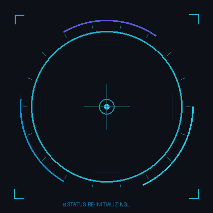
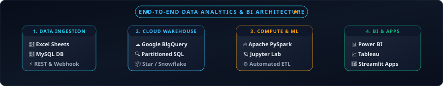

  <!-- NATIVE ANIMATED CYBER HERO BANNER -->
  

 

<!-- PROPERLY ALIGNED SPLIT HERO: PICTURE + IDENTITY + QUICK ACTIONS -->
<table border="0" width="100%">
  <tr>
    <td width="35%" align="center" valign="middle">
      
       
      <b>AKSHAY SHIVAJI RATHOD</b> 
      
      
    </td>
    <td width="65%" valign="middle">
      <h3>👋 Hello, World! I'm <a href="https://akshay-notfound.vercel.app">Akshay Shivaji Rathod</a></h3>
      

        
      

      

        A results-driven <b>Data & AI Engineer</b> and <b>Full-Stack Architect</b> specializing in building end-to-end data pipelines, executive Business Intelligence (BI) dashboards (<b>Power BI</b>, <b>Tableau</b>), distributed compute frameworks (<b>PySpark</b>, <b>BigQuery</b>), and interactive ML platforms (<b>Streamlit</b>, <b>Jupyter</b>).
      

      

        
        
        
        
        
      

    </td>
  </tr>
</table>

### 🌟 About Me & Core Capabilities

> 💡 *"I don't just build models—I build intelligent, end-to-end data ecosystems. From architecting distributed BigQuery and PySpark data pipelines to creating executive Power BI and Tableau dashboards and deploying 120 FPS liquid chrome 3D web applications, I transform raw data into definitive strategic advantage."*

<table width="100%">
  <tr>
    <td width="50%" valign="top">
      <h4>📊 Data Analytics & Business Intelligence</h4>
      <ul>
        <li><b>Executive BI Dashboards:</b> Interactive storytelling with <b>Power BI</b> (DAX modeling, Star Schemas) & <b>Tableau</b> (LOD expressions, calculated fields).</li>
        <li><b>Big Data & Cloud Warehouses:</b> High-throughput analytical processing on <b>Google BigQuery</b> and distributed big data execution with <b>Apache PySpark</b>.</li>
        <li><b>Relational & Spreadsheet Modeling:</b> Advanced SQL analytics in <b>MySQL</b> and automated financial/operational workbook modeling in <b>Microsoft Excel</b>.</li>
        <li><b>Interactive Data Apps:</b> Rapid BI prototype deployment and exploratory EDA dashboards using <b>Streamlit</b> and <b>Jupyter Notebooks</b>.</li>
      </ul>
    </td>
    <td width="50%" valign="top">
      <h4>🧠 Artificial Intelligence & ML</h4>
      <ul>
        <li><b>Generative AI & Autonomous RAG:</b> Multi-agent orchestration, semantic vector embeddings, and zero-hallucination guardrails.</li>
        <li><b>Predictive Modeling & MLOps:</b> Regression, classification, customer churn models, and demand forecasting with <b>Scikit-Learn</b>, <b>PyTorch</b>, and <b>TensorFlow</b>.</li>
        <li><b>Computer Vision:</b> Real-time facial landmark detection, eyelid gaze tracking, and assistive HCI using <b>OpenCV</b> (Virtual Eye Mouse).</li>
      </ul>
    </td>
  </tr>
  <tr>
    <td width="50%" valign="top">
      <h4>⚡ Full-Stack & Cloud Architecture</h4>
      <ul>
        <li><b>Modern Frontend:</b> Next.js 14 (App Router, Server Actions), TypeScript, React 18, and Tailwind CSS.</li>
        <li><b>Scalable Backend & APIs:</b> Microservices and high-throughput REST APIs using Python (FastAPI, Django) and Node.js.</li>
        <li><b>Cloud & Database Infrastructure:</b> Cloud deployments on GCP & Vercel with PostgreSQL, MongoDB, MySQL & Firebase.</li>
      </ul>
    </td>
    <td width="50%" valign="top">
      <h4>🎨 Creative Engineering & 3D Web</h4>
      <ul>
        <li><b>High-Performance WebGL:</b> 120 FPS liquid chrome fluid simulation running on Three.js & React Three Fiber.</li>
        <li><b>Procedural Audio Engine:</b> Dynamic Web Audio API synthesizer for sound transitions with zero external MP3s.</li>
        <li><b>Cinematic Telemetry UI:</b> Tactical anamorphic HUD telemetry, real-time FPS monitors, and spring-damped physics.</li>
      </ul>
    </td>
  </tr>
</table>

  
  
  
  

 

<!-- ANIMATED TERMINAL TELEMETRY -->

  

### 🛠️ Interactive Tech Stack & Capabilities

#### 📊 Data Analytics, Business Intelligence & Big Data

  <!-- Native Animated Dark Theme Badges matching SkillIcons styling -->
  

  
  
  
  
  
  
  
  

#### 🧠 Artificial Intelligence & Data Science

  

#### 🌐 Full-Stack & Modern Web

  

#### ⚙️ Backend, Databases & Cloud

  

#### 🔧 Developer Tools, DevOps & Mobile

  

 

<!-- ANIMATED DATA PIPELINE ARCHITECTURE FLOW -->

  

### 🚀 Featured Engineering & Analytics Projects

<table align="center" width="100%">
  <tr>
    <td width="50%" valign="top">
      <h3 align="center">🔮 DataMind AI (Automated BI &amp; Analytics)</h3>
      

        
        
        
      

      
An enterprise automated data analysis and Business Intelligence platform. Transforms raw SQL and tabular data into actionable executive insights with dynamic chart generation, automated slicers, and AI-driven exploratory modeling.

      

        <a href="https://github.com/Akshay-Notfound/datamind-analytics"><b>📂 Explore Code »</b></a>
      

    </td>
    <td width="50%" valign="top">
      <h3 align="center">📊 AutoML Web Dashboard (Streamlit &amp; MLOps)</h3>
      

        
        
        
      

      
Self-service automated machine learning and predictive analytics platform. Allows analysts to ingest raw Excel/CSV data, perform automatic EDA, train regression/classification models, and forecast supply chain demand.

      

        <a href="https://github.com/Akshay-Notfound/AutoML-Web-Dashboard"><b>📂 Explore Code »</b></a>
      

    </td>
  </tr>
  <tr>
    <td width="50%" valign="top">
      <h3 align="center">🛡️ Real-Time Fake News Detector</h3>
      

        
        
      

      
AI-driven verification engine for real-time news validation. Integrates the Mediastack API for live feeds, single-article NLP classification, and batch CSV processing with high predictive accuracy.

      

        <a href="https://github.com/Akshay-Notfound/Real-time-Fake-News-Detection"><b>📂 Explore Code »</b></a>
      

    </td>
    <td width="50%" valign="top">
      <h3 align="center">👁️ Virtual Eye Mouse (Assistive Tech)</h3>
      

        
        
      

      
Hands-free assistive human-computer interface enabling mouse control via real-time eyelid tracking and facial movements. Designed to empower users with limited physical mobility.

      

        <a href="https://github.com/Akshay-Notfound/Virtual-Eye-Mouse"><b>📂 Explore Code »</b></a>
      

    </td>
  </tr>
  <tr>
    <td width="50%" valign="top">
      <h3 align="center">🤖 GenAI RAG Analytics Agent</h3>
      

        
        
      

      
Intelligent Retrieval-Augmented Generation (RAG) agent capable of ingesting enterprise documents, synthesizing complex multi-step answers, and performing semantic search with zero hallucination guardrails.

      

        <a href="https://github.com/Akshay-Notfound/genai-rag-analytics-agent"><b>📂 Explore Code »</b></a>
      

    </td>
    <td width="50%" valign="top">
      <h3 align="center">⚡ Cinematic 3D Web Portfolio</h3>
      

        
        
      

      
A flagship cinematic web application featuring a liquid chrome 3D fluid core, Web Audio procedural synthesizer, game-style HUD telemetry, and responsive anamorphic cinema formatting.

      

        <a href="https://akshay-notfound.vercel.app"><b>🌐 Live Demo »</b></a> · <a href="https://github.com/Akshay-Notfound/Akshay-Notfound"><b>📂 Code »</b></a>
      

    </td>
  </tr>
</table>

  <table border="0">
    <tr>
      <td>
        
      </td>
      <td>
        
      </td>
    </tr>
  </table>

### 🏆 Verified Engineering Trophies & Recognition

  

 

### 📈 Contribution Velocity & Interactive Activity Graph

  

### 🐍 Contribution Activity & Snake Animation

  <picture>
    <source media="(prefers-color-scheme: dark)" srcset="https://raw.githubusercontent.com/Akshay-Notfound/Akshay-Notfound/output/github-contribution-grid-snake-dark.svg">
    <source media="(prefers-color-scheme: light)" srcset="https://raw.githubusercontent.com/Akshay-Notfound/Akshay-Notfound/output/github-contribution-grid-snake.svg">
    
  </picture>

### 📊 GitHub Analytics & Streak Metrics

  <table border="0">
    <tr>
      <td align="center" valign="middle">
        
      </td>
      <td align="center" valign="middle">
        
      </td>
    </tr>
    <tr>
      <td colspan="2" align="center">
        
      </td>
    </tr>
  </table>

### 🎯 Interactive Dossier & Deep Dive

  
<b>🕹️ Developer Battlestation & Environment (Click to expand)</b>

   
  <table>
    <tr><th>Component</th><th>Specification</th></tr>
    <tr><td><b>Operating System</b></td><td>Windows 11 Pro / Ubuntu WSL2 Linux</td></tr>
    <tr><td><b>Terminal & Shell</b></td><td>PowerShell 7 &amp; Zsh with Starship prompt</td></tr>
    <tr><td><b>Code Editor</b></td><td>VS Code &amp; Antigravity IDE (Cyber/Dark Theme, JetBrains Mono)</td></tr>
    <tr><td><b>Data &amp; BI Tooling</b></td><td>Power BI Desktop, Tableau Desktop, Google BigQuery Console, Jupyter Lab</td></tr>
    <tr><td><b>AI Tooling</b></td><td>Cursor, GitHub Copilot, Gemini CLI, Ollama Local LLMs</td></tr>
    <tr><td><b>Version Control</b></td><td>Git, GitHub CLI, Automated GitHub Actions CI/CD</td></tr>
  </table>

  
<b>📈 2026 Engineering Goals & Roadmap (Click to expand)</b>

   
  <ul>
    <li>🎯 <b>Google Cloud Professional Data Engineer (PDE)</b> Certification completion.</li>
    <li>📊 Architect real-time streaming pipelines connecting <b>BigQuery</b> with automated <b>Power BI</b> &amp; <b>Tableau</b> semantic models.</li>
    <li>🤖 Build and deploy multi-agent LLM systems with autonomous tool calling and self-healing loops.</li>
    <li>⚡ Optimize distributed <b>PySpark</b> data transformations and deep learning inference pipelines.</li>
    <li>🌐 Publish open-source React Three Fiber + Next.js interactive templates.</li>
  </ul>

  
<b>🌐 3D Portfolio Architecture Documentation (Click to expand)</b>

   
  
The code in this repository powers the <b>Cinematic 3D Portfolio</b> at <a href="https://akshay-notfound.vercel.app">akshay-notfound.vercel.app</a>:

  <ul>
    <li><b>Fluid Core:</b> 120 FPS multi-harmonic surface tension wave shader running in React Three Fiber.</li>
    <li><b>Audio Engine:</b> Procedural Web Audio API sound synthesizer with zero external audio assets.</li>
    <li><b>Tactical HUD:</b> Real-time FPS monitor, scene telemetry, and keyboard shortcuts (<code>1-7</code> to fast-travel, <code>M</code> to mute).</li>
  </ul>

---

  <!-- DYNAMIC RANDOM DEV QUOTE -->
  

    

  <!-- SOCIAL CONNECT & FOOTER -->
  

    
    
    
    
  

  Crafted with passion, data intelligence &amp; neural networks by <b>Akshay Shivaji Rathod</b>. Let's build something extraordinary together! 🚀

  <!-- FOOTER WAVE -->
  

